# ExpoPulse: design notes

A rule-based CLI that checks six layers of an Expo app (code, assets, dependencies, Expo config, Android, iOS), scores it out of 100, and applies a small set of safe fixes.

## In short

Expo apps fail store review or ship bloated for reasons that live outside JavaScript: `app.json`, the Android manifest, `Info.plist`, image files. A JS linter never sees those. ExpoPulse builds one model of the whole project, runs 59 rules across six layers, turns the findings into a damped, weighted health score, and can apply safe fixes with a preview, a backup and rollback. The core is a library with no terminal dependencies; the CLI is a thin shell over it.

## Architecture

```mermaid
flowchart LR
  n_cli["CLI (Commander)<br/>flags, exit codes 0/1/2"]
  n_config["Config loader<br/>cosmiconfig, merged defaults"]
  n_scan["Scanner<br/>one pass builds ProjectModel"]
  n_engine["Engine analyze()<br/>runs analyzers concurrently"]
  n_compare["Compare<br/>diff by findingKey"]
  n_report["Reporters<br/>JSON, MD, HTML, SARIF"]
  n_score["Scoring<br/>damped, capped, weighted"]
  n_analyzers["Six analyzers<br/>collect() a model, then rules"]
  n_backup["Backup session<br/>.expopulse/backups/#lt;time#gt;"]
  n_fix["Fix engine<br/>plan, reconcile, apply"]
  n_cli -->|"load"| n_config
  n_config -->|"config"| n_scan
  n_scan -->|"model"| n_engine
  n_engine -->|"run rules"| n_analyzers
  n_analyzers -->|"findings"| n_engine
  n_engine -->|"findings"| n_score
  n_score -->|"result"| n_report
  n_report -->|"saved JSON"| n_compare
  n_analyzers -->|"fixable"| n_fix
  n_fix -->|"save first"| n_backup
  n_backup -->|"rollback"| n_fix
  classDef key stroke-width:2px;
  class n_engine,n_analyzers key;
```

`analyze` runs left to right along the top, then back along the middle. The fix path branches off the findings and always backs up before it writes.

## How `expopulse analyze` runs

1. `apps/cli/src/index.ts` parses flags with Commander and calls `runAnalyze` inside a `guard` that maps errors to exit code 2.
2. `loadConfig` finds a config file with cosmiconfig and merges defaults, then the file, then CLI flags.
3. `scanProject` does two fast-glob passes (sources, assets) and reads `package.json`, `app.json` and `eas.json` in one `Promise.all`. The result is the shared `ProjectModel`.
4. `analyze()` selects analyzers (respecting `--only`) and runs every analyzer's `collect()` concurrently. A `null` model means that layer does not apply.
5. The code analyzer parses each file once with Babel (concurrency 16) and does one `prescan` traversal for shared facts.
6. `runRules` runs each analyzer's rules, stamps `ruleId`, `category` and `severity` from the rule's `meta`, and turns any rule that throws into a warning.
7. `computeScore` produces per-category and overall scores; reporters render the result; `decideExitCode` returns 0 clean, 1 threshold tripped, 2 tool error.
8. `fix` reuses the same analysis: plan with `dryRun`, show a preview, ask for confirmation, then back up, apply and commit. An exception triggers `session.rollback()`.

## Libraries

| Library | Used for |
| --- | --- |
| `@babel/parser, traverse, types` | JS/TS/JSX AST with `errorRecovery`, so one broken file does not stop the run. |
| `fast-glob` | File discovery, with `followSymbolicLinks: false`. |
| `cosmiconfig` | Finds the config file in any of the usual places. |
| `sharp` | Image dimensions and recompression. Lazy-loaded and optional because it is a native module. |
| `commander, chalk, ora, boxen, cli-table3` | Terminal UI. They live only in the CLI package so the core stays usable as a library. |
| `tsup, vitest, Biome, pnpm workspaces` | Build, tests, lint and format, monorepo. |

## Design decisions and trade-offs

### A rule returns drafts; the engine stamps identity

`Rule<TInput> { meta, check(input, ctx) }`. Rules return `FindingDraft[]` and the engine adds `ruleId`, `category` and `severity` from `meta`.

**Trade-off:** A rule cannot misattribute a finding. Severity can be overridden in config without touching the rule.

### Analyzer = collect + rules

Each layer builds one typed model in `collect()` and all its rules share it.

**Trade-off:** Layers are independent, so some helper code is duplicated and the assets layer re-reads files the code layer already read.

### One Babel parse per file

Each file is parsed once; a shared `prescan` gathers common facts; rules re-traverse the retained AST.

**Trade-off:** Every AST stays in memory and parsing is single-threaded, so it does not scale past one core.

### Native files read with regular expressions

Gradle, `AndroidManifest.xml` and `Info.plist` are read with regex, not XML or plist parsers.

**Trade-off:** No dependency and it never throws. Computed Gradle values and binary plists read as absent.

### Scoring that one noisy rule cannot wreck

Penalty per rule is `unit × (min(n,5) + √max(0,n−5))`, capped at 15 points. Units: info 1, warning 4, error 12, critical 25.

**Trade-off:** The cap means one critical costs the same 15 as two errors.

### Fixes are planned, previewed, backed up, then applied

`plan` has no side effects. `reconcilePlans` drops edits to files another plan deletes. `writeFileAtomic` writes a temp file then renames it.

**Trade-off:** Fixes are planned twice (preview, then apply), so images can be recompressed more than once.

### Reporters are pure functions

Each is `render(result): string`. SARIF 2.1.0 maps severities and converts 0-based columns to 1-based.

**Trade-off:** Easy to test and add. The SARIF help links currently point at the wrong repository.

### Core and CLI are separate packages

`@expopulse/core` exports everything; the CLI depends on it with `workspace:*`.

**Trade-off:** Release must publish core first, then the CLI.

## Rules by layer

- 59 rules: Expo config 19, Android 10, iOS 8, code 7, assets 7, dependencies 6, performance 2.
- Only about 9 are AST rules. The rest read config, native files, `node_modules` sizes and image bytes.
- 8 built-in fixers. Unsafe ones, such as WebP conversion, are opt-in.

## How the overall score is computed

- Category score = `round(clamp(100 − Σ penalties))`.
- Overall = weighted mean of the categories that ran: Expo 1.5, Android and iOS 1.25, the others 1.
- A layer that does not apply is marked N/A and left out, so a missing `ios/` folder is not rewarded.

## How unused assets are found

- An asset counts as referenced if its basename appears anywhere in the concatenated source and `app.json`.
- `@2x`, `@3x` and `.ios` / `.android` suffixes are stripped first, so density and platform variants match.
- It deliberately over-matches, because the fix is deletion.

## Numbers

- **Rules:** 59 across 6 layers
- **Tests:** 80 Vitest tests in 4 files (46 are regression tests)
- **Size:** about 10,800 lines in core + CLI
- **CI:** Node 20, 22, 24; pack check; CLI smoke test
- **Version:** 0.2.0 on npm (8 Aug 2026)
- **Fixers:** 8 built in

## Design FAQ

### Why not just write ESLint rules?

Only about 9 of the 59 rules look at an AST. The rest read `app.json`, `eas.json`, the Android manifest, Gradle, `Info.plist`, dependency sizes and image bytes. They need a model of the whole project, a score, and fixes that delete files, which is outside ESLint's per-file design.

### How do you stop one noisy rule dominating the score?

Square-root damping after five hits, plus a 15-point cap per rule. One rule, `no-inline-style`, produced 560 findings on a real app and motivated both.

### What makes a fix safe?

Plan and apply are separate, there is a mandatory preview, a backup is taken before any write, writes are atomic renames, deletions are guarded against paths outside the project, and an exception rolls the session back.

### What happens if a file or a rule is broken?

Babel runs with `errorRecovery`, parse failures are collected, and a rule or analyzer that throws becomes a warning. The other layers still report.

### How does `compare` survive code moving around?

A finding's key is `ruleId::file::message` and leaves the line number out. The cost is that two findings with the same message in one file collapse into one key.

### How would it scale to a very large app?

Today: one glob pass, I/O concurrency of 16, analyzers run concurrently. It does not scale past one core because Babel parsing is synchronous, and there is no incremental mode. I would add worker threads and a real cache.

### Why regex for XML and plist files?

Expo prebuild output is templated, so simple patterns are reliable there and avoid a dependency. It would be unreliable on hand-written native projects, and the code documents the misses it accepts.

### How do you decide an asset is unused?

A substring search for the basename across source and config. Dynamically built file names would be false positives, which is why the matcher is biased toward keeping files.

## Known limitations

- There is a cache module, but no analyzer reads or writes it yet. Every run is a full run.
- `--no-backup` and `--no-cache` are currently ignored: Commander stores them as `backup: false` / `cache: false` but the commands read `noBackup` / `noCache`.
- The path guard covers deletions and restores, not every modify fixer.
- It is not purely static: evaluating a dynamic `app.config.js` runs project code through `@expo/config`.
- npm serves v0.2.0 from August. The November fixes on `main` are unreleased.
- Wire up the cache, or remove it, and fix the two ignored flags.
- Most of the 59 rules have no dedicated test; coverage is strongest on regressions and scoring.
- The Expo SDK table (SDK 49 to 54) needs manual updates.
- One dead fixer targets a rule id that no rule has, and the `bundle` category and `critical` severity are unused.
- Parsing is single-threaded with all ASTs held in memory.

---

Written from the source code as it stood on 26 November 2026.
